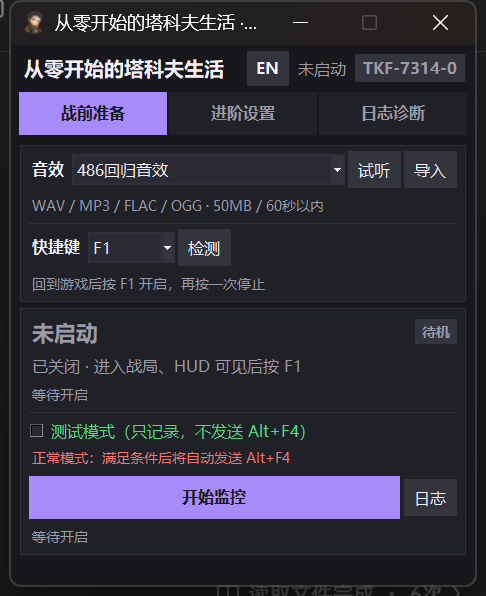
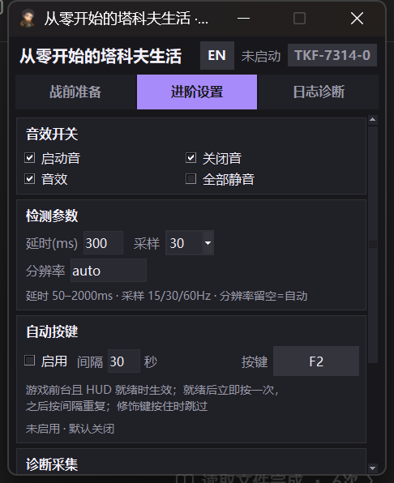
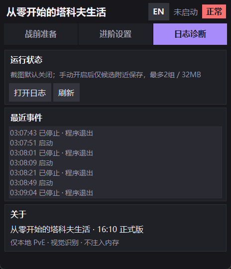
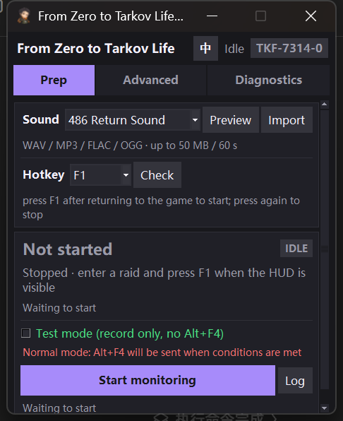
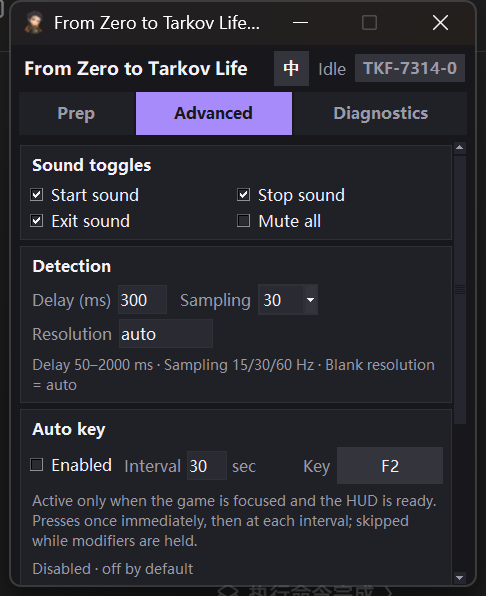
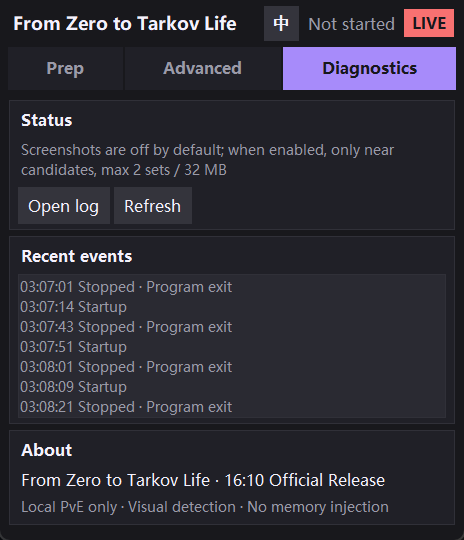

<div align="center">

# 从零开始的塔科夫生活

**From Zero to Tarkov Life**

面向《逃离塔科夫》本地 PvE 的 Windows 10/11 视觉辅助工具


</div>

> **仅建议用于本地 PvE / 离线模式。** 在线模式使用可能违反游戏规则，风险由使用者自行承担。本项目是非官方同人工具，与 Battlestate Games 没有任何关联。

## 简介

「从零开始的塔科夫生活」是一款面向《逃离塔科夫》本地 PvE 的 Windows 视觉辅助工具。它只截取屏幕顶部的 HUD，不读取游戏内存、不注入游戏进程、不修改游戏文件。

程序确认战斗 HUD 后开始监控；当 HUD 持续缺失达到设定延时，发送一次 **Alt+F4** 并自动停止监控。它会先识别背包、总览、健康、技能、地图、任务、成就、控制台、设置与游戏主页等安全界面，避免在菜单页误触发。撤离阶段会跟踪绿色横幅右侧的红色读秒，读秒归零并确认画面淡出后停止监控。

**V1.2.2 调整窗口尺寸**：窗口由 464 × 621 改为 **600 × 540**，宽度增加 136 px，高度恢复为 V1.2 的 540 px，横向布局更舒展；窗口仍固定大小、不可缩放，内容超出时按需滚动。本次不涉及检测逻辑变更。

**V1.2.1 的游戏主页识别继续保留**：主菜单背景轮换、Tarkov 标志位置变化时，检测端用 `ESCAPE` 字样模板在顶部条内做多位置、多比例匹配，六组实测主菜单都能识别为 `TKF-7314-Q`。

## 界面

### 中文

<p align="center">
  
  
  
</p>

### English

<p align="center">
  
  
  
</p>

> 截图为 V1 布局示意；V1.2.2 保持三个标签页与整体风格，窗口固定为 600 × 540。

固定 **600 × 540** 的窗口，三个标签页：

| 标签页 | 内容 |
| :--- | :--- |
| **战前准备** / Prep | 音效选择/试听/导入、快捷键、当前状态、测试模式、开始/停止监控 |
| **进阶设置** / Advanced | 音效开关、延时、采样率、自定义分辨率、自动按键、诊断采集、保存设置 |
| **日志诊断** / Diagnostics | 运行状态、实时事件、当前界面、打开日志、刷新、关于信息 |

页面内容超出时可用鼠标滚轮滚动，滚动条只在需要时出现。

## 功能

| 功能 | 说明 |
| :--- | :--- |
| **纯屏幕识别** | 只处理屏幕顶部 HUD 像素，不读取角色内存、不注入游戏进程 |
| **战斗 HUD 监控** | 综合人体轮廓、血量颜色、快捷栏横竖框、标签边缘与颜色占比判断战局 |
| **单次退出** | HUD 持续缺失达到延时后发送一次 Alt+F4，按键保持 40 ms，不自动重试 |
| **界面识别与白名单** | 识别背包、总览、健康、技能、地图、任务、成就、控制台、设置、确认与游戏主页；安全界面不会触发 Alt+F4 |
| **撤离保护** | 识别绿色撤离横幅与右侧红色读秒；`00` 持续并确认画面淡出后停止监控 |
| **中英双语** | 运行中即时切换中文 / English，语言选择自动保存 |
| **自动按键** | HUD 就绪后立即按一次，之后按设定间隔重复；游戏失焦或 HUD 消失时暂停 |
| **自定义分辨率** | 支持 `auto` 或 `2560x1600` 这样的实际分辨率，写入 `settings.json` |
| **测试模式** | 只记录候选与日志，不发送 Alt+F4，适合先验证识别效果 |
| **主题音效** | 内置多套退出音效，窗口标题、配色与图标随主题切换 |
| **日志诊断** | 实时事件、当前界面编号、详细分数日志、诊断截图与日志文件入口 |
| **管理员提示** | 首次普通权限启动时提示提权，避免 Windows UIPI 拦截模拟按键 |

## 界面识别与保护

检测端把界面编号显示在窗口右上角，编号格式为 `TKF-7314-<字母>`：

| 编号 | 界面 | 颜色与行为 |
| :--- | :--- | :--- |
| `TKF-7314-A` | 无武装战局 | 绿色；战斗分较低时作为安全界面兜底 |
| `TKF-7314-B` | 装备 / 背包 | 绿色；不触发 Alt+F4 |
| `TKF-7314-C` | 总览 | 绿色；不触发 Alt+F4 |
| `TKF-7314-D` | 健康 | 绿色；不触发 Alt+F4 |
| `TKF-7314-E` | 技能 | 绿色；不触发 Alt+F4 |
| `TKF-7314-F` | 地图 | 绿色；不触发 Alt+F4 |
| `TKF-7314-G` | 任务 | 绿色；不触发 Alt+F4 |
| `TKF-7314-O` | 成就 | 绿色；不触发 Alt+F4 |
| `TKF-7314-P` | 控制台 | 绿色；不触发 Alt+F4 |
| `TKF-7314-Q` | 游戏主页 | 绿色；不触发 Alt+F4 |
| `TKF-7314-S` | 设置 | 绿色；不触发 Alt+F4 |
| `TKF-7314-K` | 确认 | 绿色；不触发 Alt+F4 |
| `TKF-7314-H` | 转生 / 未识别页签 | 绿色；不触发 Alt+F4 |
| `TKF-7314-N` | 撤离点 | 红色；绿色横幅显示期间受保护 |
| `TKF-7314-X` | 战斗 HUD | 琥珀色；正常战局监控目标 |
| `TKF-7314-0` | 未识别 | 灰色；按普通缺失逻辑处理 |

游戏主页使用 `assets/interface/home_Q.png` 中的 `ESCAPE` 字样做灰度模板匹配：顶部条缩放到 960×120 后，按 3 种纵横比和 4 档水平比例搜索，最高得分达到 0.66 判定为 `Q`。六组实测主菜单得分为 0.699–0.947，战斗 HUD 与背包页签不会命中该模板。

撤离横幅显示期间，`N` 会返回菜单分 1.0 阻止普通缺失门控；读秒为 `00` 并确认淡出后，程序停止监控且不发送 Alt+F4。

## 快速开始

1. 从 [Releases](../../releases/latest) 下载 `从零开始的塔科夫生活_V1.2.2.zip`。
2. 解压后保持 `从零开始的塔科夫生活.exe`、`settings.json`、`icons` 在同一个目录。
3. 双击 EXE。首次启动需要解包，可能等待数秒；如果出现「管理员权限」提示，建议选择「是」。
4. 先保持「测试模式」勾选，进入本地 PvE 战局，确认 HUD、血量人形和快捷栏可见后按 **F9** 开始监控。
5. 观察右上角界面编号与状态卡「就绪」是否正常。测试模式只记录，不发送按键。
6. 依次测试背包、ESC、设置、撤离等场景，确认不会误触发。
7. 确认识别稳定后，取消测试模式，再按 F9 开始正常监控；再次按 F9 停止。
8. 需要英文界面时点击右上角 `EN`，切回中文点击 `中`。

快捷键、模式或分辨率修改后，到「进阶设置」点「保存设置」。

## 自动按键

- 在「进阶设置」中勾选「启用」，设置间隔（1–3600 秒）和按键（支持字母、数字、F1–F12、Space、Tab、Enter、Backspace）。
- 只有游戏处于前台，并且识别到战斗 HUD / 血量人形 / 快捷栏后才会触发。
- 就绪后立即按一次，之后按间隔重复；按住 Ctrl / Alt / Shift / Win 时自动跳过。
- 打开背包、菜单或 HUD 消失时会自动暂停，回到战局后重新立即按一次。
- 默认关闭；开关和配置会写入 `settings.json`。

## 自定义分辨率

在「进阶设置 → 检测参数 → 分辨率」中填写：

- `auto` 或留空：自动模式，沿用 16:10 检测配置。
- `宽x高`：例如 `2560x1600`、`1920x1080`、`3440x1440`，支持字母 `x` 或乘号 `×`。

填写后点「保存设置」才会写入配置文件。**限制**：采集逻辑仍要求游戏窗口客户区等于主显示器全屏区域；自定义分辨率只在独占全屏且显示分辨率与填写值一致时生效。无边框/窗口化模式请填写与桌面一致的分辨率，或使用 `auto`。

## 从源码构建

本仓库包含重写后的 UI 源码、检测补丁与重封包 / 校验工具。完整程序需要上游 `ID486-Tarkov-Assistant` 的 PyInstaller 基底 EXE；仓库不包含该二进制，也不包含第三方音频、图标和界面模板。

```text
.
├─ ui_compact.py           重写后的主界面与中英双语
├─ scripts/                编译、检测补丁、重封包与校验脚本
├─ assets/interface/       界面识别模板（自行准备，不提交）
├─ docs/                   构建说明、发布说明、截图
├─ requirements-build.txt  构建依赖
├─ base/                   放置上游基底 EXE（不提交）
├─ assets/                 放置图标/音频（不提交）
└─ build/                  构建输出（不提交）
```

构建步骤、模板清单与常见问题见 [docs/BUILD.md](docs/BUILD.md)。与上游的差异见 [docs/UPSTREAM.md](docs/UPSTREAM.md)。

## 版本

| 版本 | 日期 | 主要变化 |
| :--- | :--- | :--- |
| **v1.2.2** | 2026-10-22 | 窗口调整为 600×540、PE 1.2.2.0；检测逻辑与 v1.2.1 相同 |
| v1.2.1 | 2026-10-22 | 游戏主页多位置/多比例识别、`Q` 更名为「游戏主页」、窗口加高至 464×621、PE 1.2.1.0 |
| v1.2 | 2026-10-22 | 红色撤离读秒识别、`N` 横幅保护、`00` + 淡出确认、多分辨率标题匹配、TKF 编号、PE 1.2.0.0 |
| v1.0 | 2026-10-22 | 中英双语即时切换、正式版命名、日志本地化、PE 1.0.0.0 |
| v0.7.1 | 2026-10-22 | 月读主题标题简化、PE 0.7.1.0 |
| v0.7 | 2026-10-22 | 徽标位置纠正、自定义分辨率、首次运行管理员提示、PYZ 重封包 |
| v0.6 | 2026-10-22 | HUD 准入阈值修复、自动按键改为就绪触发、设置完整保存 |

完整更新记录见 [CHANGELOG.md](CHANGELOG.md)，v1.2.2 发布说明见 [docs/releases/v1.2.2.md](docs/releases/v1.2.2.md)。

## 已知限制

- 基础 HUD 识别基于 2560×1600、16:10、全屏实测；其他分辨率请使用自定义分辨率，并确认与游戏实际画面一致。
- 自定义分辨率不改采集区域，仍需独占全屏且客户区等于主屏；无边框/窗口化只支持与桌面同分辨率。
- 游戏以管理员权限运行时，本工具若不是管理员权限，Windows UIPI 会阻止模拟按键和 Alt+F4。
- 自动按键与 Alt+F4 都是模拟输入，可能被反作弊或权限策略拦截。
- 托盘图标固定为第一版图标；窗口标题、主题和窗口图标会随退出音效切换，但 EXE 文件图标不会动态变化。
- 程序未签名，首次运行可能出现 SmartScreen 提示；请确认文件来源。
- 无 UI 不等于死亡。已收录的 `A/B/C/D/E/F/G/O/P/Q/S/K/H` 界面有白名单保护；未收录的菜单、加载或转场仍可能被当作 HUD 缺失，建议先用测试模式验证。
- 撤离画面 `N` 只在绿色横幅显示期间受保护；横幅消失但读秒未确认时，后续仍按普通 HUD 缺失逻辑处理。
- 红色读秒只针对剩余时间小于 10 分钟、横幅右侧显示红字的样式；数字被遮挡或比例差异过大时可能返回未知状态。
- 游戏主页识别依赖顶部条内的 Tarkov 标志；标志被完全遮挡时可能回退为「未识别」，建议先用测试模式确认。

## 致谢与版权

- 上游项目：[liudoge66/ID486-Tarkov-Assistant](https://github.com/liudoge66/ID486-Tarkov-Assistant)，作者 Liudoge（Bilibili）。
- 本项目是在上游项目基础上进行界面重写与构建工具开发的非官方衍生作品；上游代码、二进制与素材的权利归原作者所有。
- 本仓库原创代码与文档以 MIT 许可证发布；上游衍生代码、第三方音频、图标与角色素材不在 MIT 范围内，详见 [NOTICE.md](NOTICE.md)。
- Escape from Tarkov 及相关商标归 Battlestate Games 所有。其他作品、角色与素材归各自权利人所有。

## English

**From Zero to Tarkov Life** is a Windows 10/11 visual assistant for Escape from Tarkov local PvE. It captures only the top HUD, does not read game memory or inject into the game, and sends **Alt+F4** once when the combat HUD stays missing past the configured delay. Known menus (inventory, overview, health, skills, map, quests, achievements, console, settings, confirmation and game home) are recognized and excluded from the trigger. During extraction, the red countdown on the right side of the green banner is tracked; the monitor stops after `00` is confirmed and the screen fades.

**V1.2.2** adjusts the window to 600 × 540, restoring the V1.2 height with a wider layout. The V1.2.1 game-home recognition (`TKF-7314-Q`) and the V1.2 extraction countdown protection are unchanged; detection logic is not modified in this release.

Features include HUD-ready auto-keys, custom resolution, test mode, hotkeys, themed sounds and a first-run administrator prompt. This is an unofficial fan project, not affiliated with Battlestate Games. Original code is MIT-licensed; upstream code and third-party assets are covered in [NOTICE.md](NOTICE.md). Offline PvE only; online use is at your own risk.
